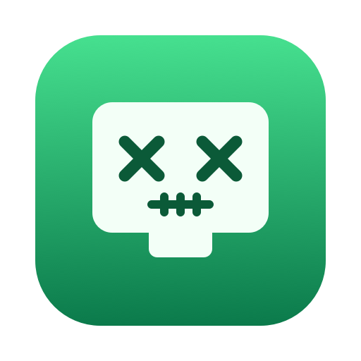

<p align="center">
  
</p>

# Zombieport

Zombieport is a macOS menu bar app that finds development servers that you forgot to
stop, such as Node.js, Bun, Deno, Python, and workerd processes that still hold a
Transmission Control Protocol (TCP) port. For each server, it shows the port, project name, Git repository, command,
working directory, process ID (PID), and uptime. You can select one or more servers and
stop them.

## Install Zombieport

Zombieport requires macOS 14 or later. You can install Zombieport with Homebrew or
download it from GitHub.

### Install with Homebrew

1. If you don't have Homebrew, install it from [the Homebrew website](https://brew.sh).
2. To install Zombieport from the CraftAtom tap, run this command:

   ```sh
   brew install --cask craftatom/tap/zombieport
   ```

3. Open **Zombieport** from the `Applications` folder. The Zombieport icon appears in the
   menu bar.

To update Zombieport, run `brew upgrade --cask zombieport`. To remove Zombieport, run
`brew uninstall --cask zombieport`. To also delete its settings, run
`brew uninstall --cask --zap zombieport`.

### Download from GitHub

1. Download `Zombieport.zip` from the
   [latest release](https://github.com/CraftAtom/zombieport/releases/latest).
2. Open the downloaded file. macOS unzips it to `Zombieport.app`.
3. Move `Zombieport.app` to your `Applications` folder.
4. Open **Zombieport** from the `Applications` folder. The Zombieport icon appears in the
   menu bar.
5. Optional: To start Zombieport when you log in, right-click the menu bar icon and click
   **Launch at Login**.

Apple notarizes every release, so macOS opens Zombieport without a security warning.

To update Zombieport, download the latest release and replace the app in your
`Applications` folder. Zombieport keeps your settings.

### Install from source

To build Zombieport yourself, you need the Xcode command line tools. To install them,
run `xcode-select --install`.

1. Clone the repository:

   ```sh
   git clone https://github.com/CraftAtom/zombieport.git
   cd zombieport
   ```

2. To build the app and copy it to `/Applications`, run the build script with the
   `--install` flag:

   ```sh
   ./build.sh --install
   ```

   To build `build/Zombieport.app` without installing it, run `./build.sh`.

## Use the window

To open the Zombieport window, click the menu bar icon. If the icon is hidden, for example
behind the camera housing, open Zombieport again from Spotlight or Finder. To see the
**Quit** option, right-click the icon.

- To select processes, click a row. To select more than one, Command-click or
  Shift-click. To select every row, click **Select All**.
- To stop the selected processes, click **Kill**, or click the list and press Delete. Zombieport
  sends `SIGTERM`, then sends `SIGKILL` if a process still runs after two seconds.
- To filter the list by name, port, path, or PID, type in the search field.
- To open a port in your browser, click the port. To sort the list, click a column
  header.
- To open a server's first port in your browser, double-click its row.
- To stop a process immediately, right-click its row and click **Force Kill (SIGKILL)**.
  The same menu has **Reveal in Finder**, **Copy Path**, **Copy Command**, and
  **Copy PID**.
- To show every process that listens on a TCP port, not only development runtimes,
  click **All Listeners** in the toolbar.

The number next to the menu bar icon counts the servers that need your attention: zombies,
whose parent shell is gone, and development servers that have run for more than 24 hours.
The window tags these rows **zombie** or **stale**. Containers never count as stale,
because databases and caches often run for days on purpose. When no server needs
attention, the menu bar shows only the icon. To change what the number counts,
right-click the icon, point to **Badge Counts**, and click an option.

Some apps run their own Node.js or Python helper that listens on a port. For example,
Raycast runs a Node.js backend, and Raycast quits when that backend stops. Zombieport
shows these rows with the app's name and tags them **app**. App processes never count as
zombies or stale, and Zombieport asks you to confirm before it stops one. A process
belongs to an app when the app's executable is inside a `.app` bundle and the app
started the process directly or through other development runtimes. A server that you
start from a terminal belongs to the shell, so it never counts as an app process.

Under each name, Zombieport shows the Git repository and a short form of the command,
such as `my-app · tsx src/server.ts`. The project name comes from the `name` field in `package.json` in the process's
working directory. If that file doesn't exist, Zombieport uses the directory name.
The list refreshes every five seconds.

## List servers from the terminal

To print the list without opening the window, run the binary with `--list`. Add `--all`
to include every listener.

```sh
build/Zombieport.app/Contents/MacOS/Zombieport --list
```

## Sign and notarize the app

An app with an ad hoc signature runs only on the Mac that built it. To share Zombieport
with other Macs, sign it with a Developer ID certificate and have Apple notarize it. You
need a membership in the Apple Developer Program.

1. To find the name of your signing identity, run this command:

   ```sh
   security find-identity -v -p codesigning
   ```

   Use the identity that starts with `Developer ID Application`.

2. To save your notary credentials in the keychain, run this command. Replace the
   placeholders with your Apple Account email address, your team ID, and a profile name
   that you choose. The command asks for an app-specific password, which you can create
   at [Apple Account](https://account.apple.com).

   ```sh
   xcrun notarytool store-credentials PROFILE_NAME \
       --apple-id APPLE_ACCOUNT_EMAIL --team-id TEAM_ID
   ```

3. To build, sign, notarize, and staple the app, run the build script with the
   `--notarize` flag:

   ```sh
   CODESIGN_IDENTITY="Developer ID Application: NAME (TEAM_ID)" \
   NOTARY_PROFILE=PROFILE_NAME ./build.sh --notarize
   ```

   The script writes the notarized app to `build/Zombieport.app` and a ZIP archive to
   share to `build/Zombieport.zip`.

The signature shows your certificate name and team ID to anyone who has the app. The
build script reads your identity from environment variables, so it never enters the
repository.

## Regenerate the icon

The app icon and the logo come from `scripts/make-icon.swift`. To regenerate
`Resources/AppIcon.icns` and `docs/logo.png` after you change the drawing code, run
the script:

```sh
swift scripts/make-icon.swift
```

## License

Zombieport is available under the MIT License. For details, see [the license file](LICENSE).
